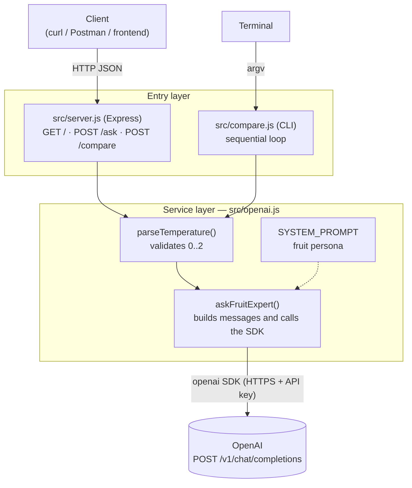
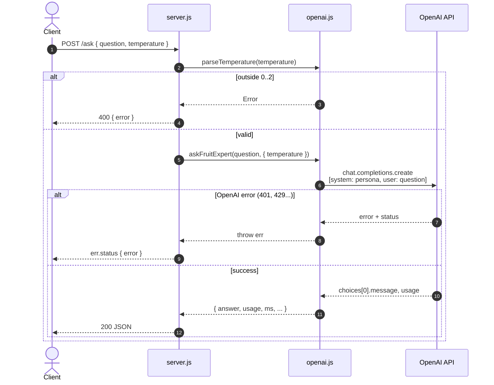
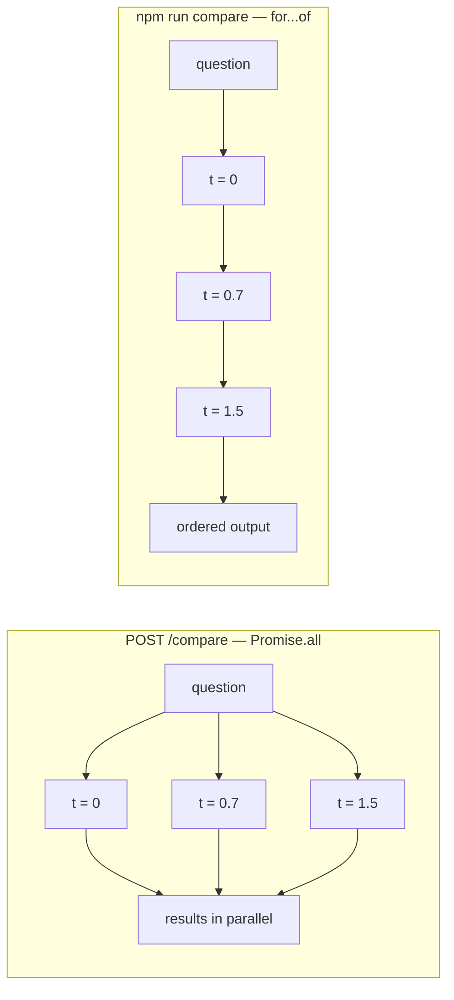
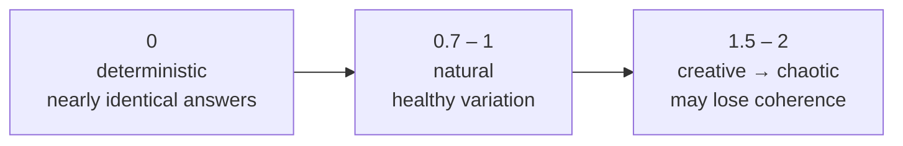

# Fruit Know-It-All — temperature lab

A Node.js service that talks to the OpenAI API with a fixed persona
(**"Você é um sabe-tudo de frutas"**, i.e. *"You are a fruit know-it-all"*) and lets you change the `temperature` to compare responses.

## Getting started

```bash
cp .env.example .env     # add your OPENAI_API_KEY
npm install
npm start                # http://localhost:3000
```

Environment variables:

| Variable | Default | Description |
|---|---|---|
| `OPENAI_API_KEY` | — (required) | Your OpenAI API key |
| `OPENAI_MODEL` | `gpt-4o-mini` | Chat model (must accept `temperature`) |
| `PORT` | `3000` | HTTP server port |

## Architecture



| Layer | File | Responsibility |
|---|---|---|
| Entry | `src/server.js`, `src/compare.js` | Read input, validate it, format the output |
| Service | `src/openai.js` | Persona, model, temperature and the SDK call |
| External | OpenAI | Generate the text |

All the logic lives in `openai.js`, so the HTTP server and the CLI share the same function. To switch providers, you only change that file.

## Request flow (`POST /ask`)



## `/compare` (parallel) vs CLI (sequential)



- **`/compare`**: sends every temperature at once. It's faster, but uses your quota all at once.
- **CLI**: one temperature at a time, so the terminal output comes out in order.

## Endpoints

### `GET /`
Shows the model and system prompt in use.

### `POST /ask`
```bash
curl -X POST localhost:3000/ask -H 'content-type: application/json' \
  -d '{"question":"What is the sweetest fruit?","temperature":0.2}'
```
```json
{
  "temperature": 0.2,
  "model": "gpt-4o-mini-...",
  "answer": "...",
  "finishReason": "stop",
  "usage": { "prompt_tokens": 80, "completion_tokens": 120, "total_tokens": 200 },
  "ms": 1350
}
```

### `POST /compare`
```bash
curl -X POST localhost:3000/compare -H 'content-type: application/json' \
  -d '{"question":"Invent a fruit juice","temperatures":[0,0.8,1.6]}'
```
Returns `{ question, results: [ ...one /ask-style object per temperature ] }`.

### CLI
```bash
npm run compare -- "Tell me about cashew fruit" 0 1 1.8
```

## What to look for when changing temperature



- Ask the same question several times at `0`, then at `1.5`, and compare.
- Reasoning models (o-series, GPT-5) **do not accept** `temperature`. Use a regular chat model.
- The service is **stateless**: each call sends only `system` + `user`. For conversation memory, you'd need to store and resend the `messages[]` history.
- The system prompt tells the model to answer in Portuguese. Edit `SYSTEM_PROMPT` in `src/openai.js` to change that.
