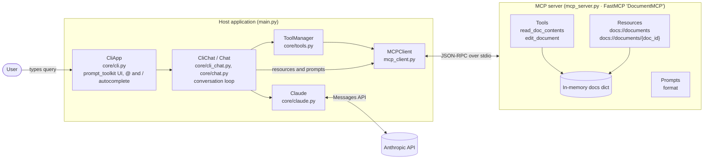
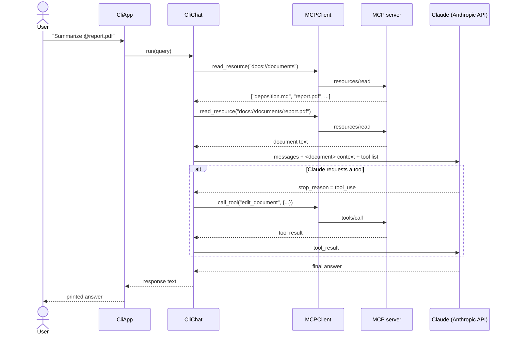

# MCP Chat — Document Read/Write Tool

A command-line chat app that talks to Claude through the Anthropic API and uses the
[Model Context Protocol (MCP)](https://modelcontextprotocol.io) to give the model access
to a small set of documents. The MCP server exposes **tools** (read and edit a document),
**resources** (list and fetch documents) and **prompts** (reusable commands such as `/format`).

## Table of contents

- [Architecture](#architecture)
- [MCP server capabilities](#mcp-server-capabilities)
  - [Tools](#tools)
  - [Resources](#resources)
  - [Prompts](#prompts)
- [Setup](#setup)
- [Running](#running)
  - [Interactive chat](#interactive-chat)
  - [Client smoke test](#client-smoke-test)
  - [MCP Inspector](#mcp-inspector)
- [Demos](#demos)
- [Project structure](#project-structure)
- [Development](#development)

## Architecture

`main.py` starts the CLI, which spawns `mcp_server.py` as a child process and talks to it
over **stdio**. Claude never calls the server directly: the chat loop asks Claude for a
response, and when Claude requests a tool, `ToolManager` routes the call to the right
`MCPClient` and sends the result back to Claude.



### Request flow

How a single query moves through the system, including the `@mention` resource lookup and a tool call:



## MCP server capabilities

The server lives in [`mcp_server.py`](mcp_server.py) and keeps documents in an in-memory
dictionary, so **edits are lost when the server restarts**. Available document IDs:

| Document ID       | Content summary                                     |
| ----------------- | --------------------------------------------------- |
| `deposition.md`   | Testimony of Angela Smith, P.E.                     |
| `report.pdf`      | State of a 20m condenser tower                      |
| `financials.docx` | Project budget and expenditures                     |
| `outlook.pdf`     | Projected future performance of the system          |
| `plan.md`         | Steps for the project's implementation              |
| `spec.txt`        | Technical requirements for the equipment            |

### Tools

Tools are functions the **model** decides to call.

| Name                | Description                                                         | Arguments                                                                                                 |
| ------------------- | ------------------------------------------------------------------- | --------------------------------------------------------------------------------------------------------- |
| `read_doc_contents` | Reads a document and returns its contents as a string.              | `doc_id` *(string, required)*: ID of the document to read.                                               |
| `edit_document`     | Edits a document by replacing a string in its content with another. | `doc_id` *(string, required)*: document to edit<br>`old_str` *(string, required)*: exact text to replace, including whitespace<br>`new_str` *(string, required)*: replacement text |

Both tools raise `Doc with id <doc_id> not found` when the ID doesn't exist.
`edit_document` replaces **every** occurrence of `old_str`.

### Resources

Resources are read-only data the **application** fetches to give the model context.

| URI                         | MIME type          | Returns                                      |
| --------------------------- | ------------------ | -------------------------------------------- |
| `docs://documents`          | `application/json` | A list of all document IDs.                  |
| `docs://documents/{doc_id}` | `text/plain`       | The contents of a single document (template). |

In the chat, typing `@` lists the documents from `docs://documents`. Mentioning a document
(for example `@report.pdf`) makes the client fetch `docs://documents/report.pdf` and put the
content into the prompt, so Claude doesn't need to call a tool to read it.

### Prompts

Prompts are reusable message templates the **user** triggers as slash commands.

| Name     | Description                                              | Arguments                                         |
| -------- | -------------------------------------------------------- | ------------------------------------------------- |
| `format` | Rewrites the contents of a document in Markdown format. | `doc_id` *(string, required)*: document to format. |

Usage in the chat:

```
> /format plan.md
```

The prompt tells Claude to restructure the document with headers, bullet points and tables,
and to save the result with the `edit_document` tool.

## Setup

### Prerequisites

- Python 3.10+
- [uv](https://github.com/astral-sh/uv) (recommended)
- An Anthropic API key
- Node.js with `npx` (only for the MCP Inspector)

### Environment variables

Create a `.env` file in the project root:

```env
ANTHROPIC_API_KEY="your-api-key"
CLAUDE_MODEL="claude-sonnet-5-5"
USE_UV=1
```

| Variable            | Required | Description                                                                         |
| ------------------- | -------- | ----------------------------------------------------------------------------------- |
| `ANTHROPIC_API_KEY` | yes      | Your Anthropic API secret key.                                                     |
| `CLAUDE_MODEL`      | yes      | Claude model ID used by the chat.                                                  |
| `USE_UV`            | no       | `1` starts the server with `uv run mcp_server.py`; `0` (default) uses `python`. |

### Install dependencies

```bash
uv sync
```

Without uv:

```bash
python -m venv .venv
source .venv/bin/activate        # Windows: .venv\Scripts\activate
pip install "anthropic<1" python-dotenv prompt-toolkit "mcp[cli]>=1.8.0,<2"
```

Set `USE_UV=0` in `.env` when you're not using uv.

## Running

### Interactive chat

```bash
uv run main.py
```

The CLI starts the MCP server for you. Inside the chat:

| Input                       | What it does                                              |
| --------------------------- | --------------------------------------------------------- |
| Plain text                  | Chat with Claude.                                         |
| `@<doc_id>`                 | Adds that document's content to the query (resource).     |
| `/<prompt> <doc_id>`        | Runs a server prompt, for example `/format plan.md`.     |
| `Tab`                       | Autocompletes document IDs and commands.                  |

Extra MCP servers can be passed as arguments. Each one is started with `uv run <script>`
and its tools become available to Claude:

```bash
uv run main.py other_server.py
```

### Client smoke test

Checks that the client can start the server and list its tools, without calling Claude:

```bash
uv run mcp_client.py
```

### MCP Inspector

The [MCP Inspector](https://github.com/modelcontextprotocol/inspector) is a web UI for
calling the server's tools, resources and prompts by hand. Run it against the **server**
file, not `main.py`:

```bash
uv run mcp dev mcp_server.py
```

Then:

1. Open the URL printed in the terminal (usually `http://localhost:6274`).
2. Click **Connect**.
3. Use the **Tools**, **Resources** and **Prompts** tabs to list items and run them with your own arguments.

> `uv run mcp main.py` fails with `No such command 'main.py'`, because the `mcp` CLI
> expects a subcommand (`dev`, `run`, `install`). Use `uv run main.py` for the chat and
> `uv run mcp dev mcp_server.py` for the inspector.

## Demos

### Resources: mentioning documents with `@`


https://github.com/user-attachments/assets/f0343696-fde6-4cf9-8ad0-2cb2211f15a9


### Prompts: formatting a document with `/format`


https://github.com/user-attachments/assets/52976ef5-1688-486c-9a4a-b20b341d874c


## Project structure

```
.
├── main.py            # Entry point: loads .env, starts MCP clients and the CLI
├── mcp_server.py      # MCP server: tools, resources and prompts (FastMCP)
├── mcp_client.py      # MCPClient: stdio connection, tools, prompts, resources
├── core/
│   ├── cli.py         # prompt_toolkit UI, autocomplete for @ and /
│   ├── cli_chat.py    # Resource mentions, slash commands, prompt conversion
│   ├── chat.py        # Base chat loop with the tool-use cycle
│   ├── claude.py      # Anthropic API wrapper
│   └── tools.py       # ToolManager: collects tools and routes tool calls
├── pyproject.toml
└── .env               # Not committed
```

## Development

- **Add documents:** edit the `docs` dictionary in `mcp_server.py`.
- **Add a tool, resource or prompt:** decorate a function with `@mcp.tool`,
  `@mcp.resource` or `@mcp.prompt` in `mcp_server.py`. Prompts appear as `/` commands in
  the chat automatically.
- **Planned:** a `summarize` prompt (see the TODO in `mcp_server.py`).
- There are no lint or type checks configured.
