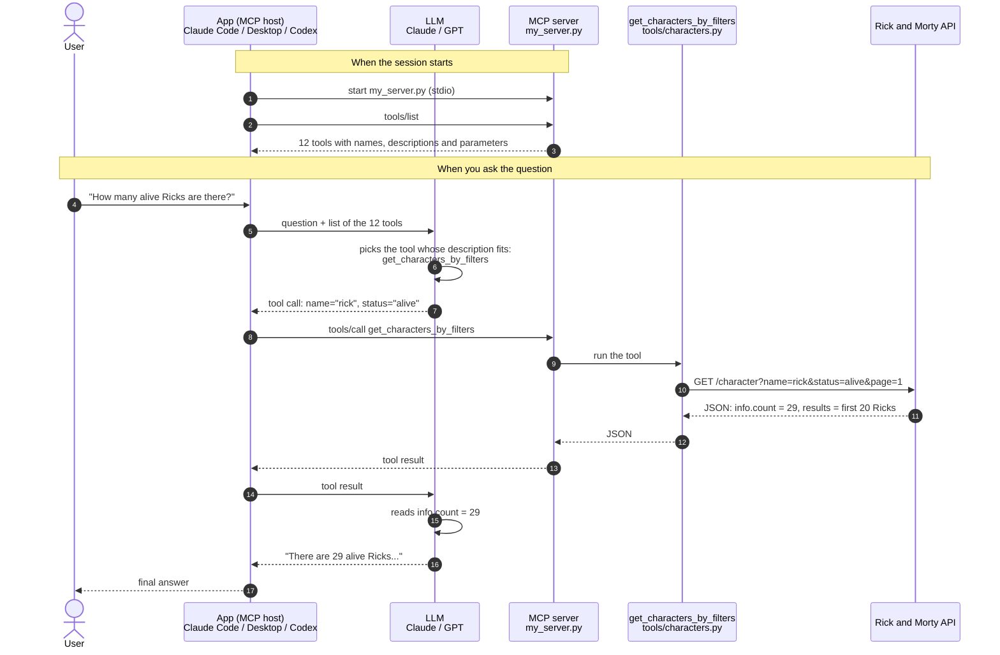

# Rick and Morty MCP

An MCP server that exposes the [Rick and Morty API](https://rickandmortyapi.com/documentation) as tools, so an AI assistant can look up characters, locations and episodes.
 
## Tools


## What happens when you ask "How many alive Ricks are there?


## Questions to test
```txt
"How many alive Ricks are there?"
"Who appears in episode S01E01?"
"Which planets are in dimension C-137?"
"List the episodes of season 2"
```

## Demo

#### Claude code terminal

https://github.com/user-attachments/assets/8439f8cf-d86e-4682-9ff9-0dcee23f55a7

#### Claude code desktop

https://github.com/user-attachments/assets/aa3a0a6e-4891-4cef-b425-cecc271c0f35

