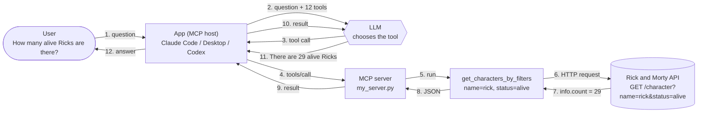

# Rick and Morty MCP

An MCP server that exposes the [Rick and Morty API](https://rickandmortyapi.com/documentation) as tools, so an AI assistant can look up characters, locations and episodes.
 
## Tools


## What happens when you ask "How many alive Ricks are there?



## Steps

1. You ask the question in the app.
2. The app sends the question and the 12 available tools to the LLM.
3. The LLM picks `get_characters_by_filters` and returns the call with `name="rick"` and `status="alive"`.
4. The app sends the call to the MCP server.
5. The server runs the tool in `tools/characters.py`.
6. The tool calls the Rick and Morty API.
7. The API answers with `info.count = 29`.
8. The tool returns the JSON to the server.
9. The server returns the result to the app.
10. The app passes the result to the LLM.
11. The LLM writes the answer.
12. The app shows the answer to you.

The LLM only chooses the tool and its arguments; the app is the one that runs it.

## Questions to test
```txt
"How many alive Ricks are there?"
"Who appears in episode S01E01?"
"Which planets are in dimension C-137?"
"List the episodes of season 2"
```

## Demo

#### Claude code terminal

https://github.com/user-attachments/assets/8439f8cf-d86e-4682-9ff9-0dcee23f55a7

#### Claude code desktop

https://github.com/user-attachments/assets/aa3a0a6e-4891-4cef-b425-cecc271c0f35

