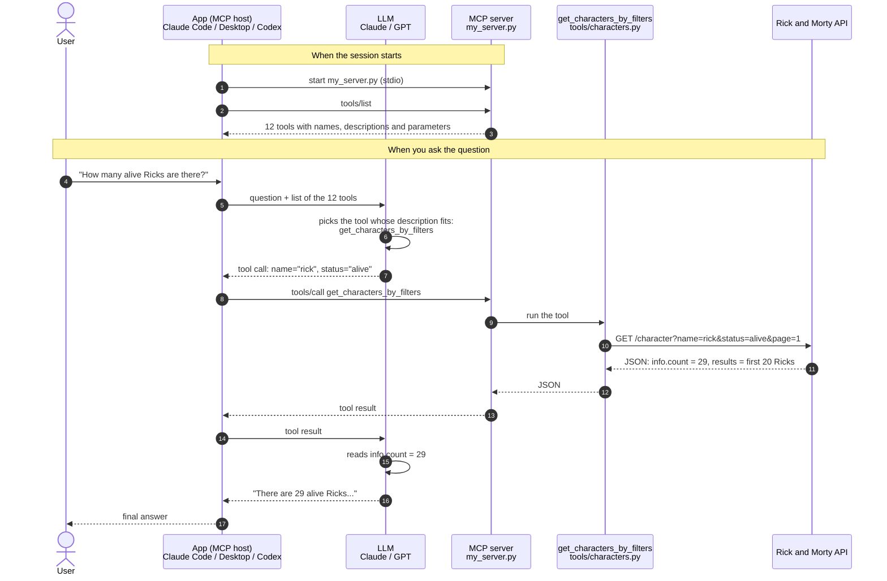

# Rick and Morty MCP

An MCP server that exposes the [Rick and Morty API](https://rickandmortyapi.com/documentation) as tools, so an AI assistant can look up characters, locations and episodes.
 
## Tools


## How to run inspector
```bash
uv sync
uv run fastmcp dev inspector my_server.py --project .
```
1. Open the link printed in the terminal, including the token: `http://127.0.0.1:6274?MCP_INSPECTOR_API_TOKEN=...`
2. Click **Connect**.
3. Open the **Tools** tab and click **List Tools**. The 12 tools show up.
4. Pick a tool, fill in its parameters (for example `get_characters_by_filters` with `name = rick` and `status = alive`) and click **Run Tool**.

## How to run on Claude and Codex
The server runs locally: each app starts it by itself, so there is nothing to keep running. Run the commands from this folder (`$PWD`).

```bash
uv sync
```

> If an app can't find `uv`, use its full path (`which uv`, e.g. `/opt/homebrew/bin/uv`).

#### Claude Code (terminal)
```bash
claude mcp add -s user rick-and-morty -- uv run --project "$PWD" fastmcp run "$PWD/my_server.py"
```
Open a new `claude` session and type `/mcp` to check it.

#### Claude Desktop
Quit the app first (`Cmd+Q`), otherwise it can overwrite the config. Then run:
```bash
uv run fastmcp install claude-desktop my_server.py --project . --name rick-and-morty
```
Open the app again. The server shows up under the tools icon in the chat.

#### Codex (terminal and desktop app)
Both use `~/.codex/config.toml`, so one command covers both:
```bash
codex mcp add rick-and-morty -- uv run --project "$PWD" fastmcp run "$PWD/my_server.py"
```
- **Terminal:** open a new `codex` session and type `/mcp` to check it.
- **Desktop app:** quit it (`Cmd+Q`) and open it again.

#### Remove
```bash
claude mcp remove rick-and-morty -s user
codex mcp remove rick-and-morty
```
For Claude Desktop, delete the `rick-and-morty` entry from `~/Library/Application Support/Claude/claude_desktop_config.json`.

## What happens when you ask "How many alive Ricks are there?


## Questions to test
```txt
"How many alive Ricks are there?"
"Who appears in episode S01E01?"
"Which planets are in dimension C-137?"
"List the episodes of season 2"
```

## Demo

#### Claude code terminal

https://github.com/user-attachments/assets/8439f8cf-d86e-4682-9ff9-0dcee23f55a7

#### Claude code desktop

https://github.com/user-attachments/assets/aa3a0a6e-4891-4cef-b425-cecc271c0f35

